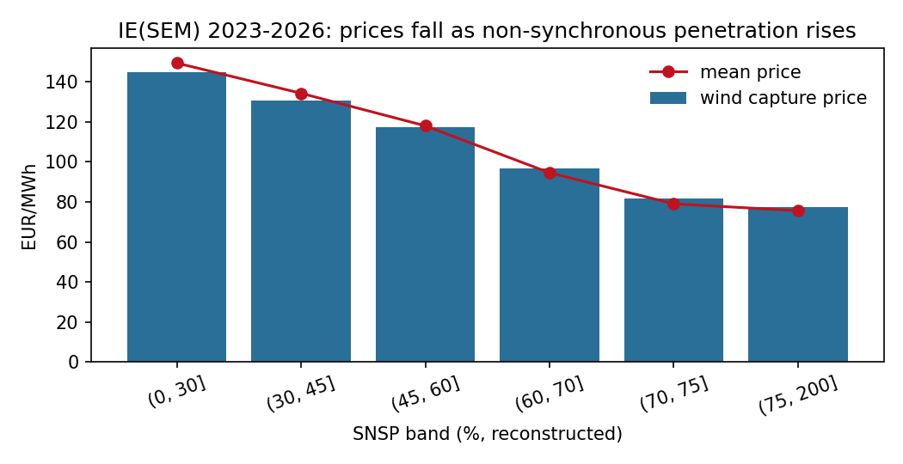
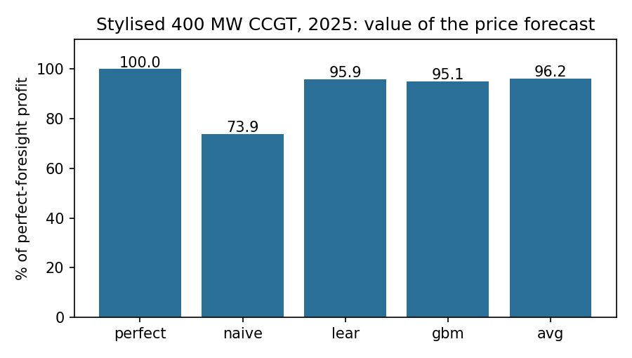

# ie-isem-market

The Irish all-island electricity market (I-SEM, bidding zone IE(SEM)) from open data, January 2023 to October 2026: price formation, wind capture prices and system non-synchronous penetration (SNSP), day-ahead price forecasting, and what a better forecast is worth to a gas-fired plant.

Research study on public data, not a trading tool. Everything below is the output of the run described at the end.

## Questions and answers

| Question | Result |
|---|---|
| What sets the price? | Hourly OLS 2023-2025: 1 EUR/MWh more CCGT fuel and carbon cost moves the price by 1.24 EUR/MWh (t 90); 1 GW more residual load (load minus wind) by 25.8 EUR/MWh (t 100); R² 0.55. Fuel pass-through above 1 is expected because Irish gas costs sit above the TTF proxy used here. |
| What is wind worth? | Wind capture rate 85-93% of the time-weighted price (2023 92.7%, 2024 85.5%, 2025 88.6%, 2026 to October 87.5%). The monthly regression of the capture rate on the wind share of load has slope -0.16 points per point but is not significant (t -1.5, 45 months): the cannibalisation is clear across the hours of the system, not in the month-to-month series. |
| What does SNSP do? | Reconstructed SNSP is at least 70% in 7.7% of hours and at least 75% in 2.3%. Mean price falls from 149 EUR/MWh (SNSP up to 30%) to 76 (above 75%); wind capture price from 145 to 78. In hours with SNSP of 70% or more, the EirGrid wind forecast exceeds the wind actually produced by 730 MW on average against 147 MW otherwise, the signature of dispatch-down of wind (the gap also contains forecast error). |
| How well can day-ahead prices be forecast? | Test year 2025, all 24 hours of a day with the information of day d-1. MAE: naive 36.1, LEAR 18.6, gradient boosting 19.6, average of both 18.1 EUR/MWh (relative MAE 0.52, 0.54 and 0.50). LEAR beats naive (Diebold-Mariano z 14.9) and beats gradient boosting (z 3.0 in favour of LEAR). |
| What is the forecast worth? | Stylised 400 MW CCGT, daily commitment, settled at the realised day-ahead price, 2025: profit with yesterday's prices 73.9% of the perfect-foresight profit, with LEAR 95.9%, gradient boosting 95.1%, the average 96.2%. A forecast is worth about 22 points of profit and the models recover almost all of it. |




## Data

| Source | Content |
|---|---|
| ENTSO-E Transparency Platform | day-ahead price IE(SEM), actual load, generation by type, day-ahead wind forecast, net physical flows between IE(SEM) and Great Britain |
| EirGrid Smart Grid Dashboard | all-island wind actual and forecast, system demand (15 minutes) |
| World Bank Pink Sheet, ECB, EEX | monthly TTF gas, EUR/USD, EUA auction prices (same loaders as the German study, to December 2025) |

Data quality (`results/quality_report.csv`, `results/price_anomalies.csv`): 2.5% of hourly prices missing, no duplicates. ENTSO-E actual load is missing in some quarters and is filled with the dashboard system demand. A day-ahead load forecast is not openly available for IE(SEM): the forecast models use the same hour one week earlier as load proxy. Zero flows are not published, so missing flow hours count as zero, including a flat stretch of about 1,800 hours where the interconnector series is absent. 243 hours are flagged by a rolling robust z-score (above 6) for review.

## Method

1. `prep.py`: hourly table, data checks, anomaly flags.
2. `fundamentals.py`: summary statistics, capture prices, cannibalisation regression, bands by SNSP and wind share, price drivers. SNSP is reconstructed as (wind + solar + HVDC imports) / (demand + HVDC exports); EirGrid's own series is not available through the open API, so levels can differ by a few points from the published value. Limit assumed 75%.
3. `forecast.py`: naive, LEAR (LASSO per hour, rolling 728 days, weekly recalibration) and gradient boosting (monthly recalibration), the set-up and evaluation of the German study (de-power-market-ppa).
4. `thermal.py`: unit commitment of a generic CCGT (400 MW, minimum 160 MW, efficiency 55% and 50%, start 12,000 EUR, minimum up and down time 4 hours) as a MILP per day with carry-over of the state, solved with HiGHS through SciPy.

## Limits

- Day-ahead price only. No balancing market, intraday, capacity market, DS3 system services or gas nomination. The plant is a price taker that self-schedules, which is not how I-SEM units are offered in practice (complex bids in the day-ahead and balancing markets).
- Gas is the monthly TTF, not NBP plus Irish transport; carbon is the EU allowance price. Fuel data end in December 2025, so forecasts and plant values cover 2025 only. The CCGT profit (about 230 thousand EUR per MW and year with perfect foresight) is the margin of an efficient assumed unit at these fuel costs, not the profit of any real station.
- SNSP is a reconstruction. Wind dispatch-down is inferred from a forecast gap, not from EirGrid dispatch-down reports. The dashboard wind series covers about 40% of the hours.
- Capture rates are conditional on hours with wind output; the relation between wind and price within hours is confounded with demand level and season.
- No gas shipping from the NBP to the island, no retail or hedging analysis.

## Run

```
pip install -e ".[test]"
python scripts/download.py        # ENTSO-E token needed
python -c "from isem.run import main; main()"
python -c "from isem.plots import main; main()"
pytest -q                         # offline, synthetic data
```
